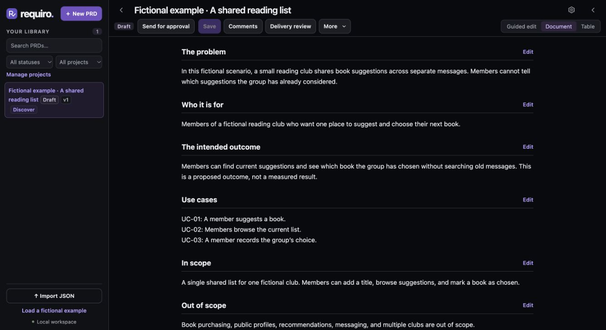
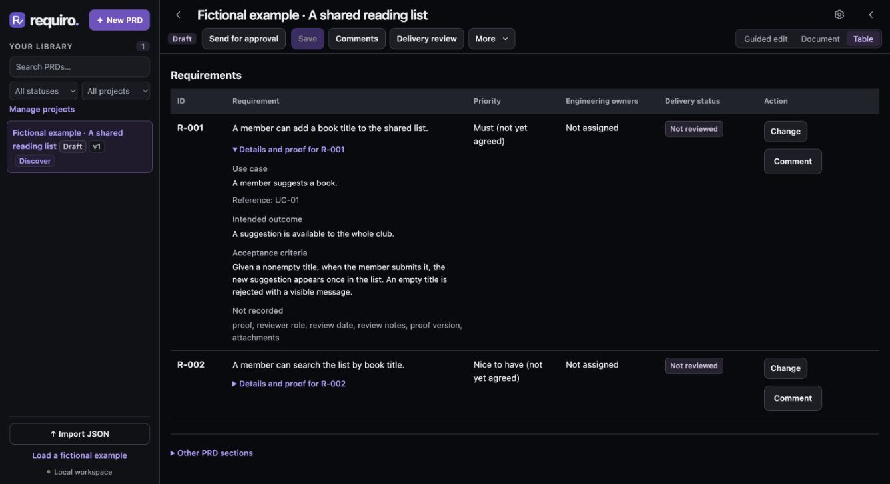
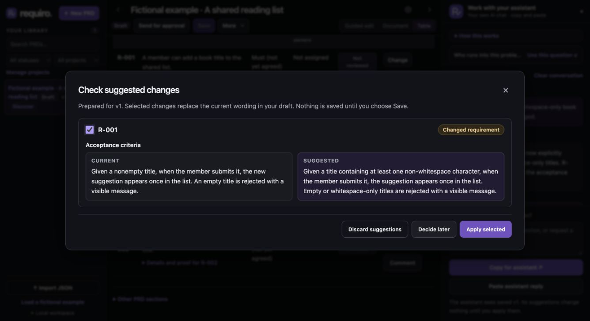

# Prototype · Requiro product requirements workspace

## Open it

The prototype helps a product manager (PM) write and maintain a product
requirements document (PRD): what a product must do and how to check it. It
requires Python 3.10 or newer; no package installation or AI service key is
needed. From the top folder of the repository:

```sh
cd 02-prototype/app
python3 server.py
```

Open [the local prototype](http://127.0.0.1:8765). This address works on the
computer running the server; it is not a hosted reviewer link. The source and
these instructions let a reviewer run their own copy. The README also describes
private personal access through GitHub Codespaces.

## What it demonstrates

The prototype provides a document library and an editor that guides the PM
through writing a PRD. Each requirement keeps its ID across edits. Saved
revisions are numbered versions of the document. The PM can review proposed
wording, save it, and approve a specific revision. They can also restore older
content as a new draft, archive and reopen a document, and export or import its
current content as Markdown or JSON.

Chat responses come from the human’s chosen assistant chat, which is separate
from this app. The app prepares a context packet: the selected PRD, its saved
revision and conversation, the assistant’s operating instructions, and the
current request. The human copies this
packet to the assistant and pastes a reply back. A reply can contain a proposal,
meaning suggested wording that the PM reviews before applying and saving it.
The app does not connect to an AI model or generate its own responses.

## Current limits

The app runs on your computer or in a private Codespace. Browser sessions using
the same running app share requirement comments. Access for other team members
is not configured. Saved data stays in that workspace; exported current-document
files do not include every historical revision.
Only synthetic or approved public nonconfidential material is permitted.
The human determines whether the material is permitted; the assistant’s
instructions do not detect confidential information. Time saved, continued use, and PRD quality remain unmeasured.

## Debrief

**Question explored:** can a PM keep control of requirement wording and approval
while using an assistant to suggest edits?

**Design result:** the prototype keeps suggested wording separate from the
saved PRD. A proposed change must identify the document and the saved revision
it was based on. The PM chooses which changes to apply. Saving, sending for approval, and
approving are separate actions. Keeping the model outside the app makes this
boundary visible and avoids storing model-service credentials.

**Trade-off:** every AI interaction requires copying a packet to another chat
and pasting its response back. This adds manual work. The assistant may return
a reply that the app cannot use or that refers to an older saved revision. An integrated model connection is not
part of this prototype.

**Not measured:** no study with PM users, comparison of drafting times,
measurement of continued use, or independent scoring of AI responses has been
completed. The metrics plan and human scoring rubric define the next evaluation.

## Repeatable fictional walkthrough

1. Choose the fictional reading-list example or create an empty PRD. Note its
   document ID and version, and enter a fictional user need.
2. Ask the assistant to clarify one requirement using **Copy for assistant**.
   Paste the packet into the chosen assistant chat, then paste the complete
   reply back with **Paste assistant reply** and **Check reply**.
3. Compare current and proposed wording. Apply one selected change and save.
   Check that unrelated requirements retain their wording and IDs.
4. Try a reply with a different document ID or an older base revision (saved
   version number). The app should reject that proposal without applying it.
   Prepare a packet for the current document and revision rather than forcing
   the change.
5. Export the current PRD as Markdown and JSON. Inspect the exported ID,
   version, and requirements. Import the JSON as a new Draft; do not expect
   approval, comments, proof, or full revision history to transfer.

This is a demonstration procedure with expected behavior, not a record of a
user study. Any recorded test outcomes belong with the test log.

## Screenshots

### Document view



Read the problem, intended users, outcomes, and scope as one document.

### Requirements table



Compare requirements, priorities, and delivery status. Expand a requirement to
inspect its acceptance criteria.

### Review suggested changes



Compare the current and suggested wording before applying a change. Applying it
and saving the document are separate actions.
